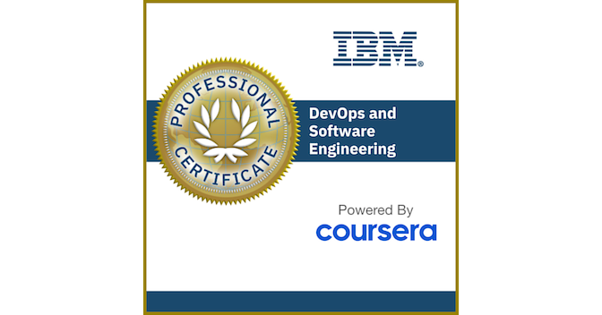

# Hi, I'm Lamar Glass

**AI Engineer | Machine Learning | Deep Learning | Computer Vision | DevOps**

I design and build intelligent systems that bridge the gap between research and production. My work spans the full ML lifecycle — from data pipelines and model development to deployment and optimization.

---

## What I Do

- **Deep Learning**: CNNs, Vision Transformers (ViT), hybrid architectures, transfer learning
- **ML Engineering**: Model training, evaluation, optimization, and reproducible pipelines
- **Data Engineering**: ETL processes, data augmentation, preprocessing pipelines
- **MLOps**: Experiment tracking, model versioning, deployment workflows
- **DevOps**: CI/CD pipelines, containerization (Docker/Kubernetes), Agile & Scrum

---

## Tech Stack

| Category | Tools |
|----------|-------|
| **Languages** | Python, SQL, Bash, Rust |
| **ML/DL Frameworks** | PyTorch, TensorFlow, Keras, scikit-learn |
| **Data & Visualization** | Pandas, NumPy, Matplotlib, Plotly, SciPy |
| **MLOps & Experiment Tracking** | MLflow, DVC |
| **Tools & Infrastructure** | Git, Docker, Kubernetes, Linux, VS Code, CUDA |
| **CI/CD & DevOps** | GitHub Actions, OpenShift, Continuous Integration & Delivery |
| **LLMs & Generative AI** | Hugging Face Transformers, Ollama, LangChain |

---

## Certificates

### IBM AI Engineering Professional Certificate
*13 courses · Jul 2026 · [Verify](https://www.coursera.org/verify/professionalCert/IX7TH7BIKNNI)*

  
  

**Courses:** Introduction to Deep Learning · Deep Learning with Keras and TensorFlow · Introduction to Neural Networks and PyTorch · Deep Learning with PyTorch · Generative AI and LLMs · AI Agents with RAG and LangChain · Introduction to Computer Vision and Image Processing · Building Deep Learning Models with PyTorch · Applied Machine Learning in Python · Machine Learning with Python · AI for Everyone · Python for Data Science, AI & Development · AI Capstone Project with Deep Learning

**Skills:** CNNs, Vision Transformers (ViT), transfer learning, Keras, TensorFlow, PyTorch, NLP, recommendation systems, GenAI, LLMs, RAG, LangChain, model training & deployment

---

### IBM Deep Learning with PyTorch, Keras and TensorFlow
*5 courses · Jul 2026 · [Verify](https://www.coursera.org/verify/professionalCert/6I4U3O0LVNAB)*

  
  

**Courses:** Introduction to Deep Learning & Neural Networks with Keras · Deep Learning with Keras and TensorFlow · Introduction to Neural Networks and PyTorch · Deep Learning with PyTorch · AI Capstone Project with Deep Learning

**Skills:** CNNs, deep learning models, Keras, TensorFlow, PyTorch, NLP, transformers, unsupervised learning, reinforcement learning, model optimization

---

### IBM DevOps and Software Engineering
*15 courses · Aug 2026 · [Verify](https://www.coursera.org/verify/professionalCert/8KRD7DWO64K2)*

  
  

**Courses:** Introduction to DevOps · Introduction to Cloud Computing · Introduction to Agile Development and Scrum · Introduction to Software Engineering · Getting Started with Git and GitHub · Hands-on Introduction to Linux Commands and Shell Scripting · Python for Data Science, AI & Development · Developing AI Applications with Python and Flask · Introduction to Containers w/ Docker, Kubernetes & OpenShift · Application Development using Microservices and Serverless · Introduction to Test and Behavior Driven Development · Continuous Integration and Continuous Delivery (CI/CD) · Application Security for Developers and DevOps Professionals · Monitoring and Observability for Development and DevOps · DevOps Capstone Project

**Skills:** Agile/Scrum, Python, Linux, Shell scripting, Git, Docker, Kubernetes, OpenShift, CI/CD, microservices, serverless, TDD/BDD, application security, monitoring & observability

---

### Course Projects

- Built CNN-ViT hybrid models for land classification
- Implemented custom data loading pipelines (generator-based & memory-based)
- Comparative analysis of Keras vs PyTorch model performance — full materials in the [IBM AI Engineering repo](https://github.com/Lamar-Glass/IBM-AI-Engineering-Professional-Certificate)

---

## Let's Connect

---

  <i>"Building intelligent systems that combine innovation with practical utility."</i>

