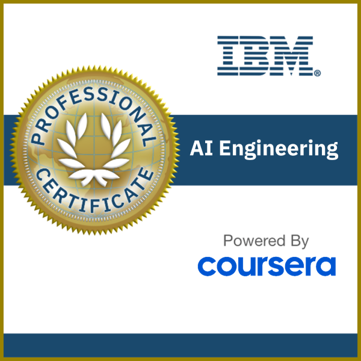

# Hi, I'm Lamar Glass

**AI Engineer | Machine Learning | Deep Learning | Computer Vision | DevOps**

I design and build intelligent systems that bridge the gap between research and production. My work spans the full ML lifecycle — from data pipelines and model development to deployment and optimization.

---

## What I Do

- **Deep Learning**: CNNs, Vision Transformers (ViT), hybrid architectures, transfer learning
- **ML Engineering**: Model training, evaluation, optimization, and reproducible pipelines
- **Data Engineering**: ETL processes, data augmentation, preprocessing pipelines
- **MLOps**: Experiment tracking, model versioning, deployment workflows
- **DevOps**: CI/CD pipelines, containerization (Docker/Kubernetes), Agile & Scrum

---

## Tech Stack

| Category | Tools |
|----------|-------|
| **Languages** | Python, SQL, Bash, Rust |
| **ML/DL Frameworks** | PyTorch, TensorFlow, Keras, scikit-learn |
| **Data & Visualization** | Pandas, NumPy, Matplotlib, Plotly, SciPy |
| **MLOps & Experiment Tracking** | MLflow, DVC |
| **Tools & Infrastructure** | Git, Docker, Kubernetes, Linux, VS Code, CUDA |
| **CI/CD & DevOps** | GitHub Actions, OpenShift, Continuous Integration & Delivery |
| **LLMs & Generative AI** | Hugging Face Transformers, Ollama, LangChain |

---

## Certificates

  
  

- [IBM AI Engineering Professional Certificate](https://www.coursera.org/verify/professionalCert/IX7TH7BIKNNI) — 13 courses, Jul 2026 — PyTorch/Keras/TF, ViTs, GenAI & LLMs, RAG agents with LangChain
- [IBM Deep Learning with PyTorch, Keras and TensorFlow](https://www.coursera.org/verify/professionalCert/6I4U3O0LVNAB) — 5 courses, Jul 2026 — CNNs, transformers, unsupervised learning, reinforcement learning
- [IBM DevOps and Software Engineering](https://www.coursera.org/verify/professionalCert/8KRD7DWO64K2) — 15 courses, Aug 2026 — Python, Docker/K8s/OpenShift, CI/CD, microservices, Agile/Scrum

### Course Projects

- Built CNN-ViT hybrid models for land classification
- Implemented custom data loading pipelines (generator-based & memory-based)
- Comparative analysis of Keras vs PyTorch model performance — full materials in the [IBM AI Engineering repo](https://github.com/Lamar-Glass/IBM-AI-Engineering-Professional-Certificate)

---

## Let's Connect

---

  <i>"Building intelligent systems that combine innovation with practical utility."</i>

