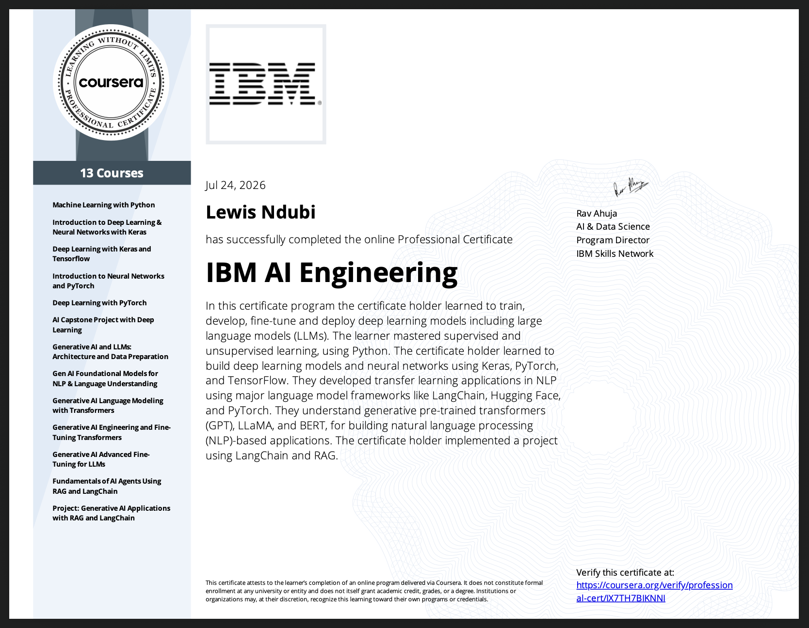

<div align="center">

<!-- Animated typing header -->
<a href="https://github.com/Lamar-Glass">
  
</a>

<br/>

<!-- Profile badges -->

<a href="https://github.com/Lamar-Glass?tab=followers">
  
</a>
<a href="https://github.com/Lamar-Glass?tab=repositories">
  
</a>

<br/><br/>

**AI Engineer** building reliable, scalable, and reproducible intelligent systems —
from data engineering and model development to deployment, optimization, and infrastructure.

</div>

---

## 🧭 About Me

- 🔬 **AI Engineering** — Machine learning, deep learning, and generative AI across the full lifecycle.
- 👁️ **Computer Vision** — CNNs, Vision Transformers (ViT), hybrid architectures, and transfer learning.
- ⚙️ **ML Engineering** — Training, evaluation, optimization, and reproducible workflows.
- 🗄️ **Data Engineering** — ETL, preprocessing, augmentation, and data pipelines.
- 📦 **MLOps** — Experiment tracking, model versioning, and deployment.
- 🚀 **DevOps** — CI/CD, Docker, Kubernetes, Linux, and cloud-native infrastructure.

> 🎯 **Focus:** turning research into production-grade, reproducible AI systems.

---

## 🛠️ Tech Stack

<div align="center">

**Languages**


**Machine & Deep Learning**


**Generative AI & CV**


**MLOps, DevOps & Cloud**


</div>

---

## 📊 GitHub Analytics

<div align="center">


<br/>


<br/>


<br/>


</div>

---

## 🏅 Certifications

### 🎓 IBM AI Engineering Professional Certificate
**13 Courses · July 2026** · [Verify Certificate](https://www.coursera.org/verify/professionalCert/IX7TH7BIKNNI)

<p align="center">
  <a href="https://www.coursera.org/account/accomplishments/specialization/IX7TH7BIKNNI">
    
  </a>
  &nbsp;&nbsp;
  <a href="https://www.credly.com/badges/faee1b72-3312-45a4-8b95-39b715d590c7/public_url">
    
  </a>
</p>

**Skills:** Deep Learning · CNNs · Vision Transformers · Transfer Learning · PyTorch · TensorFlow · Keras · NLP · Recommendation Systems · Generative AI · LLMs · RAG · LangChain

<details>
<summary><b>📚 View coursework (13 courses)</b></summary>

- Introduction to Deep Learning
- Deep Learning with Keras and TensorFlow
- Introduction to Neural Networks and PyTorch
- Deep Learning with PyTorch
- Generative AI and LLMs
- AI Agents with RAG and LangChain
- Introduction to Computer Vision and Image Processing
- Building Deep Learning Models with PyTorch
- Applied Machine Learning in Python
- Machine Learning with Python
- AI for Everyone
- Python for Data Science, AI & Development
- AI Capstone Project with Deep Learning

</details>

---

### 🎓 IBM Deep Learning with PyTorch, Keras and TensorFlow
**5 Courses · July 2026** · [Verify Certificate](https://www.coursera.org/verify/professionalCert/6I4U3O0LVNAB)

<p align="center">
  <a href="https://www.coursera.org/account/accomplishments/professional-cert/6I4U3O0LVNAB">
    
  </a>
  &nbsp;&nbsp;
  <a href="https://www.credly.com/org/coursera/badge/ibm-deep-learning-with-pytorch-keras-and-tensorflow">
    
  </a>
</p>

**Skills:** Neural Networks · Deep Learning · PyTorch · TensorFlow · Keras · NLP · Transformers · Unsupervised Learning · Reinforcement Learning · Model Optimization

<details>
<summary><b>📚 View coursework (5 courses)</b></summary>

- Introduction to Deep Learning & Neural Networks with Keras
- Deep Learning with Keras and TensorFlow
- Introduction to Neural Networks and PyTorch
- Deep Learning with PyTorch
- AI Capstone Project with Deep Learning

</details>

---

### 🎓 IBM DevOps and Software Engineering Professional Certificate
**15 Courses · August 2026** · [Verify Certificate](https://www.coursera.org/verify/professionalCert/8KRD7DWO64K2)

<p align="center">
  <a href="https://www.coursera.org/account/accomplishments/professional-cert/8KRD7DWO64K2">
    
  </a>
  &nbsp;&nbsp;
  <a href="https://www.credly.com/badges/df9bb77c-3be0-49cf-8f7e-4decf37b7b7e/public_url">
    
  </a>
</p>

**Skills:** Agile/Scrum · Python · Linux · Shell Scripting · Git · Docker · Kubernetes · OpenShift · CI/CD · Microservices · Serverless · TDD/BDD · Application Security · Monitoring & Observability

<details>
<summary><b>📚 View coursework (15 courses)</b></summary>

- Introduction to DevOps
- Introduction to Cloud Computing
- Introduction to Agile Development and Scrum
- Introduction to Software Engineering
- Getting Started with Git and GitHub
- Hands-on Introduction to Linux Commands and Shell Scripting
- Python for Data Science, AI & Development
- Developing AI Applications with Python and Flask
- Introduction to Containers with Docker, Kubernetes & OpenShift
- Application Development using Microservices and Serverless
- Introduction to Test and Behavior Driven Development
- Continuous Integration and Continuous Delivery (CI/CD)
- Application Security for Developers and DevOps Professionals
- Monitoring and Observability for Development and DevOps
- DevOps Capstone Project

</details>

---

## 🚀 Selected Projects & Technical Work

### 👁️ Computer Vision & Deep Learning
- Developed **CNN–Vision Transformer (ViT) hybrid models** for land classification.
- Built custom data-loading pipelines using generator-based and memory-based approaches.
- Explored image preprocessing and data augmentation techniques.

### ⚖️ Deep Learning Framework Evaluation
- Conducted comparative analysis of **Keras vs. PyTorch** model performance.
- Worked with model training, evaluation, and optimization workflows.

<div align="center">

[](https://github.com/Lamar-Glass/IBM-AI-Engineering-Professional-Certificate)

</div>

---

## 🌱 Areas of Interest

`Artificial Intelligence` · `Deep Learning Architectures` · `Computer Vision & Geospatial Intelligence` · `LLMs & AI Agents` · `Retrieval-Augmented Generation` · `Distributed Systems & Cloud` · `MLOps & Production AI` · `DevSecOps & Infrastructure Automation`

---

## 🤝 Let's Connect

<div align="center">

<a href="mailto:lamarvantaglass@gmail.com">
  
</a>
<a href="https://www.linkedin.com/in/lamarglass">
  
</a>
<a href="https://github.com/Lamar-Glass">
  
</a>

</div>

---

## 💖 Support My Work

If my work is useful to you, consider supporting my independent research, engineering experiments, and open-source development. Every contribution helps. 🙏

###  Bitcoin (BTC)

```text
bc1qlavqxnn3ezt8qhqvvv0w0qgt776wr42jleytwc
```

###  Monero (XMR)

<p align="center">
  
</p>

```text
88vSE7fSMuWiVrxjquYN842pKV1gUfxMGFpsmfnfWtsZJFEUWxDhz3SghAMpuhUowpPJYEVsVV1oZB1uEDAtcHusTfAgrfy
```

---

<div align="center">

<i>"Building intelligent systems that combine innovation with practical utility."</i>

<br/><br/>

<sub>© 2026 Lamar Glass · Crafted with curiosity and code.</sub>

</div>
