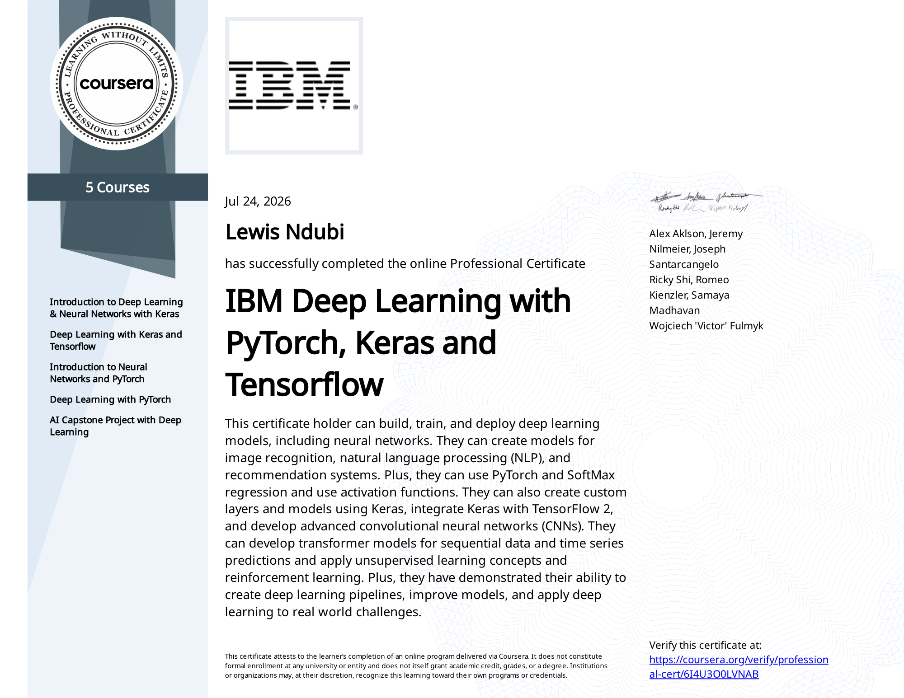
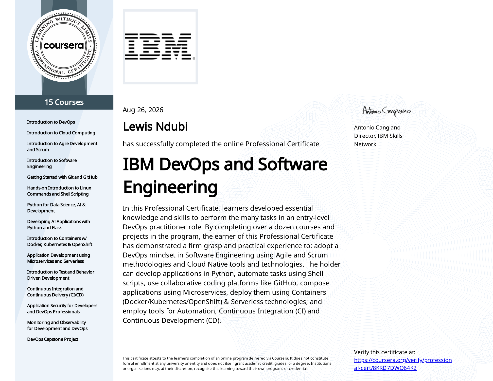

Hi, I'm Lamar Glass

AI Engineer | Machine Learning | Deep Learning | Computer Vision | DevOps

I design and develop intelligent systems, combining machine learning research with practical software engineering. My interests span the full AI lifecycle, from data engineering and model development to deployment, optimization, and infrastructure.

My focus is on building reliable, scalable, and reproducible intelligent systems.

About Me

AI Engineering: Machine learning, deep learning, and generative AI.

Computer Vision: CNNs, Vision Transformers (ViT), hybrid architectures, and transfer learning.

ML Engineering: Model training, evaluation, optimization, and reproducible workflows.

Data Engineering: ETL, preprocessing, data augmentation, and data pipelines.

MLOps: Experiment tracking, model versioning, and deployment workflows.

DevOps: CI/CD, Docker, Kubernetes, Linux, and cloud-native infrastructure.

Technical Stack

Category

Technologies

Programming Languages

Python, SQL, Bash, Rust

Machine Learning

Scikit-learn, NumPy, Pandas, SciPy

Deep Learning

PyTorch, TensorFlow, Keras

Computer Vision

CNNs, Vision Transformers, Image Processing

Generative AI

Hugging Face Transformers, Ollama, LangChain, RAG

Data Visualization

Matplotlib, Plotly

MLOps & Experiment Tracking

MLflow, DVC

DevOps & Infrastructure

Docker, Kubernetes, OpenShift, Linux

CI/CD

GitHub Actions, Continuous Integration, Continuous Delivery

Development Tools

Git, GitHub, VS Code, CUDA

Certifications

IBM AI Engineering Professional Certificate

13 Courses · July 2026

Verify Certificate

  
  

Coursework:

Introduction to Deep Learning

Deep Learning with Keras and TensorFlow

Introduction to Neural Networks and PyTorch

Deep Learning with PyTorch

Generative AI and LLMs

AI Agents with RAG and LangChain

Introduction to Computer Vision and Image Processing

Building Deep Learning Models with PyTorch

Applied Machine Learning in Python

Machine Learning with Python

AI for Everyone

Python for Data Science, AI & Development

AI Capstone Project with Deep Learning

Skills: Deep Learning, CNNs, Vision Transformers, Transfer Learning, PyTorch, TensorFlow, Keras, NLP, Recommendation Systems, Generative AI, LLMs, RAG, LangChain.

IBM Deep Learning with PyTorch, Keras and TensorFlow

5 Courses · July 2026

Verify Certificate

  
  

Coursework:

Introduction to Deep Learning & Neural Networks with Keras

Deep Learning with Keras and TensorFlow

Introduction to Neural Networks and PyTorch

Deep Learning with PyTorch

AI Capstone Project with Deep Learning

Skills: Neural Networks, Deep Learning, PyTorch, TensorFlow, Keras, NLP, Transformers, Unsupervised Learning, Reinforcement Learning, Model Optimization.

IBM DevOps and Software Engineering Professional Certificate

15 Courses · August 2026

Verify Certificate

  
  

Coursework:

Introduction to DevOps

Introduction to Cloud Computing

Introduction to Agile Development and Scrum

Introduction to Software Engineering

Getting Started with Git and GitHub

Hands-on Introduction to Linux Commands and Shell Scripting

Python for Data Science, AI & Development

Developing AI Applications with Python and Flask

Introduction to Containers with Docker, Kubernetes & OpenShift

Application Development using Microservices and Serverless

Introduction to Test and Behavior Driven Development

Continuous Integration and Continuous Delivery (CI/CD)

Application Security for Developers and DevOps Professionals

Monitoring and Observability for Development and DevOps

DevOps Capstone Project

Skills: Agile/Scrum, Python, Linux, Shell Scripting, Git, Docker, Kubernetes, OpenShift, CI/CD, Microservices, Serverless, TDD/BDD, Application Security, Monitoring and Observability.

Selected Projects & Technical Work

Computer Vision & Deep Learning

Developed CNN–Vision Transformer (ViT) hybrid models for land classification.

Implemented custom data-loading pipelines using generator-based and memory-based approaches.

Explored image preprocessing and data augmentation techniques.

Deep Learning Framework Evaluation

Conducted comparative analysis of Keras and PyTorch model performance.

Worked with model training, evaluation, and optimization workflows.

Project Repository:

IBM AI Engineering Professional Certificate

Areas of Interest

Artificial Intelligence and Machine Learning

Deep Learning Architectures

Computer Vision and Geospatial Intelligence

Large Language Models and AI Agents

Retrieval-Augmented Generation (RAG)

Distributed Systems and Cloud Infrastructure

MLOps and Production AI Systems

DevSecOps and Infrastructure Automation

Let's Connect

  
  
  

Support My Work

If you find my work useful and would like to support my independent research, engineering experiments, and open-source development, donations are appreciated.

Bitcoin (BTC)

  

Bitcoin Network

bc1qlavqxnn3ezt8qhqvvv0w0qgt776wr42jleytwc

Monero (XMR)

  

Monero Network

88vSE7fSMuWiVrxjquYN842pKV1gUfxMGFpsmfnfWtsZJFEUWxDhz3SghAMpuhUowpPJYEVsVV1oZB1uEDAtcHusTfAgrfy

  <i>Every contribution helps support independent engineering, research, and open-source development.</i>

  <i>"Building intelligent systems that combine innovation with practical utility."</i>

  © 2026 Lamar Glass. All rights reserved.

