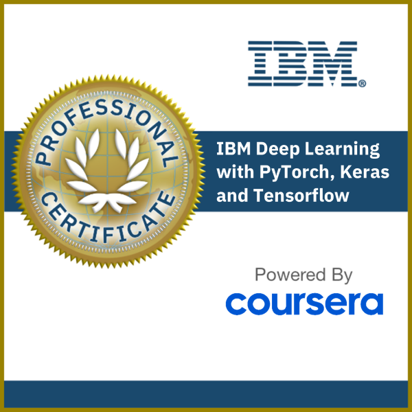

<!-- Animated typing header -->

 

<!-- Profile badges -->

  

**Applied AI research & engineering** — computer vision, generative systems, and reproducible ML infrastructure.

---

## Research Focus

> **Theme:** turning experimental models into reliable, reproducible intelligent systems.

- **Computer Vision & Geospatial Intelligence** — CNNs, Vision Transformers (ViT), hybrid architectures, transfer learning.
- **Generative AI & Retrieval** — LLMs, retrieval-augmented generation (RAG), agents, LangChain, Hugging Face.
- **Model Evaluation** — comparing framework workflows and optimizing training pipelines.
- **Data-Centric ML** — ETL, preprocessing, augmentation, data pipelines, and custom loaders.
- **MLOps & Infrastructure** — experiment tracking, model versioning, containers, CI/CD, cloud-native deployment.

---

## Selected Work

### CNN–ViT hybrids for land classification
- Developed **CNN–Vision Transformer (ViT) hybrid models** for land classification.
- Built custom data-loading pipelines using generator-based and memory-based approaches.
- Explored image preprocessing and data augmentation strategies.

### Deep learning framework evaluation
- Conducted comparative analysis of **Keras vs. PyTorch** model performance.
- Worked with model training, evaluation, and optimization workflows.

---

## Methods & Tooling

**Languages**

**Machine & Deep Learning**

**Generative AI & Computer Vision**

**MLOps, DevOps & Cloud**

---

## Training & Certifications

### IBM AI Engineering Professional Certificate
**13 courses · July 2026** · [Verify Certificate](https://www.coursera.org/verify/professionalCert/IX7TH7BIKNNI)

  
  &nbsp;&nbsp;
  

**Coverage:** Deep Learning · CNNs · Vision Transformers · Transfer Learning · PyTorch · TensorFlow · Keras · NLP · Recommendation Systems · Generative AI · LLMs · RAG · LangChain

<b>View coursework (13 courses)</b>

- Introduction to Deep Learning
- Deep Learning with Keras and TensorFlow
- Introduction to Neural Networks and PyTorch
- Deep Learning with PyTorch
- Generative AI and LLMs
- AI Agents with RAG and LangChain
- Introduction to Computer Vision and Image Processing
- Building Deep Learning Models with PyTorch
- Applied Machine Learning in Python
- Machine Learning with Python
- AI for Everyone
- Python for Data Science, AI & Development
- AI Capstone Project with Deep Learning

---

### IBM Deep Learning with PyTorch, Keras and TensorFlow
**5 courses · July 2026** · [Verify Certificate](https://www.coursera.org/verify/professionalCert/6I4U3O0LVNAB)

  
  &nbsp;&nbsp;
  

**Coverage:** Neural Networks · Deep Learning · PyTorch · TensorFlow · Keras · NLP · Transformers · Unsupervised Learning · Reinforcement Learning · Model Optimization

<b>View coursework (5 courses)</b>

- Introduction to Deep Learning & Neural Networks with Keras
- Deep Learning with Keras and TensorFlow
- Introduction to Neural Networks and PyTorch
- Deep Learning with PyTorch
- AI Capstone Project with Deep Learning

---

### IBM DevOps and Software Engineering Professional Certificate
**15 courses · August 2026** · [Verify Certificate](https://www.coursera.org/verify/professionalCert/8KRD7DWO64K2)

  
  &nbsp;&nbsp;
  

**Coverage:** Agile/Scrum · Python · Linux · Shell Scripting · Git · Docker · Kubernetes · OpenShift · CI/CD · Microservices · Serverless · TDD/BDD · Application Security · Monitoring & Observability

<b>View coursework (15 courses)</b>

- Introduction to DevOps
- Introduction to Cloud Computing
- Introduction to Agile Development and Scrum
- Introduction to Software Engineering
- Getting Started with Git and GitHub
- Hands-on Introduction to Linux Commands and Shell Scripting
- Python for Data Science, AI & Development
- Developing AI Applications with Python and Flask
- Introduction to Containers with Docker, Kubernetes & OpenShift
- Application Development using Microservices and Serverless
- Introduction to Test and Behavior Driven Development
- Continuous Integration and Continuous Delivery (CI/CD)
- Application Security for Developers and DevOps Professionals
- Monitoring and Observability for Development and DevOps
- DevOps Capstone Project

---

## GitHub Activity

 

---

## Collaboration & Contact

Interested in applied computer vision, retrieval-augmented systems, and reproducible ML infrastructure.

`Artificial Intelligence` · `Deep Learning Architectures` · `Computer Vision & Geospatial Intelligence` · `LLMs & AI Agents` · `Retrieval-Augmented Generation` · `Distributed Systems & Cloud` · `MLOps & Production AI` · `DevSecOps & Infrastructure Automation`

---

<i>"Building intelligent systems that combine innovation with practical utility."</i>

  

© 2026 Lamar Glass · Crafted with curiosity and code.

